# PocketStore – Catálogo Offline con Vanilla JS

Aplicación web progresiva (PWA) de una sola página que lista usuarios obtenidos de la API pública
[JSONPlaceholder](https://jsonplaceholder.typicode.com/) y que **funciona sin conexión a internet**.

- **Estudiante:** Moira Villalobos Hinojos
- **Materia:** Aplicaciones Web Progresivas – Dr. Alfonso José Barroso Barajas
- **Grupo:** IDGS102N


## Estructura del proyecto

```
/pocket-store
├── index.html      # Vista (App Shell)
├── styles.css      # Estilos del App Shell
├── app.js          # Lógica de la aplicación y registro del SW
├── sw.js           # Service Worker y caché
├── manifest.json   # Manifiesto de instalación
├── icons/          # Iconos 192x192 y 512x512
└── img/            # Capturas del proceso de desarrollo
```

## Cómo ejecutarlo


Los Service Workers solo funcionan en `localhost` o HTTPS, por lo que el proyecto no se abre con doble clic en `index.html`.

1. Abrir la carpeta `pocket-store` en VS Code.
2. Instalar la extensión **Live Server**.
3. Clic derecho sobre `index.html` → **Open with Live Server**.
4. Se abre `http://127.0.0.1:5500` en el navegador.

## Proceso de desarrollo

### 1. Manifiesto (`manifest.json`)
Se creó manifest con `name`, `short_name`, `start_url`, `display: "standalone"`, `theme_color`,
`background_color` y dos iconos (192x192 y 512x512).

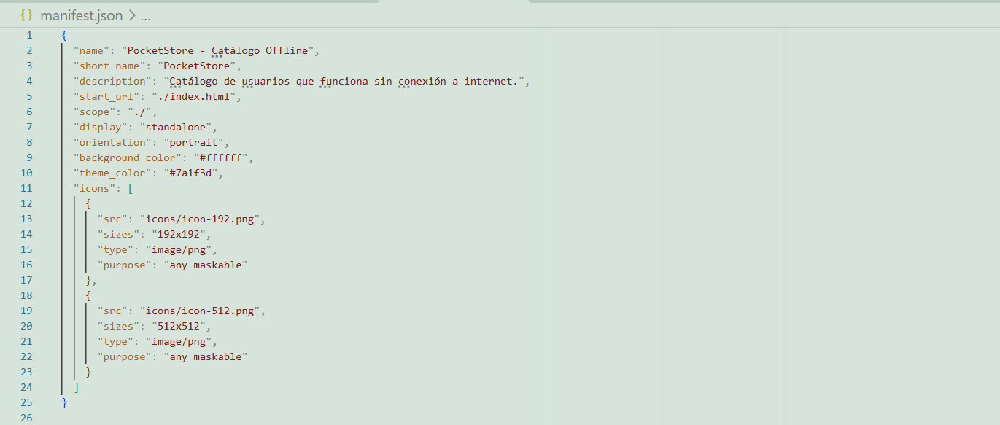

### 2. App Shell (`index.html` y `styles.css`)
Estructura estática con barra superior, contenedor principal y pie de página, que carga al instante
mientras el contenido dinámico llega después.

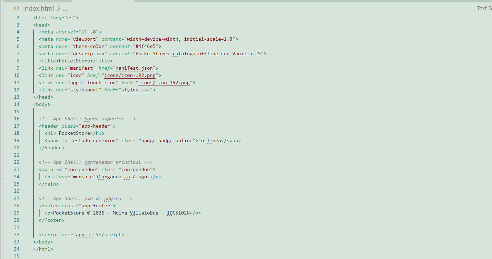
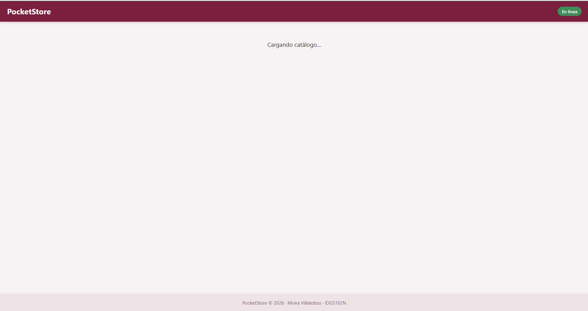

### 3. Service Worker (`sw.js`)
Ciclo de vida: `install` (precache del shell), `activate` (limpieza de cachés viejas) y `fetch`
(Cache First para el shell, Network First con respaldo en caché para la API).

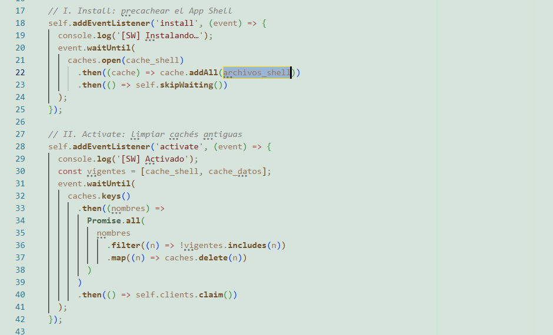
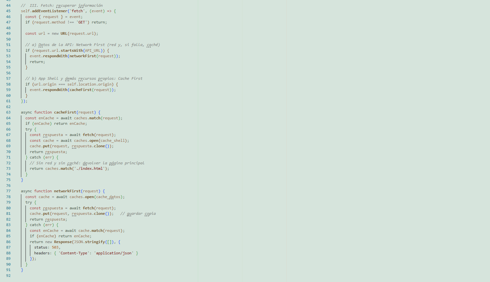

### 4. Contenido dinámico (`app.js`)
Registro del SW y consumo de `https://jsonplaceholder.typicode.com/users` con `fetch()`.

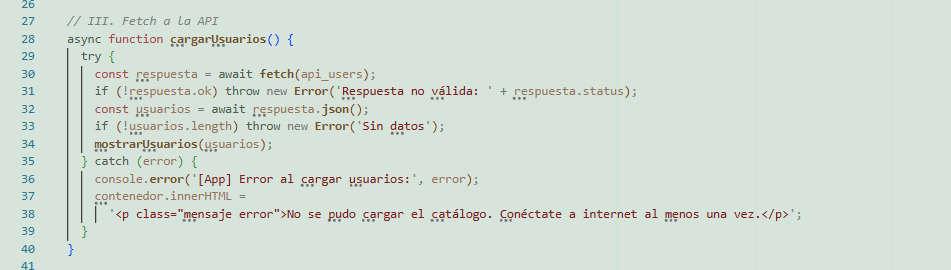
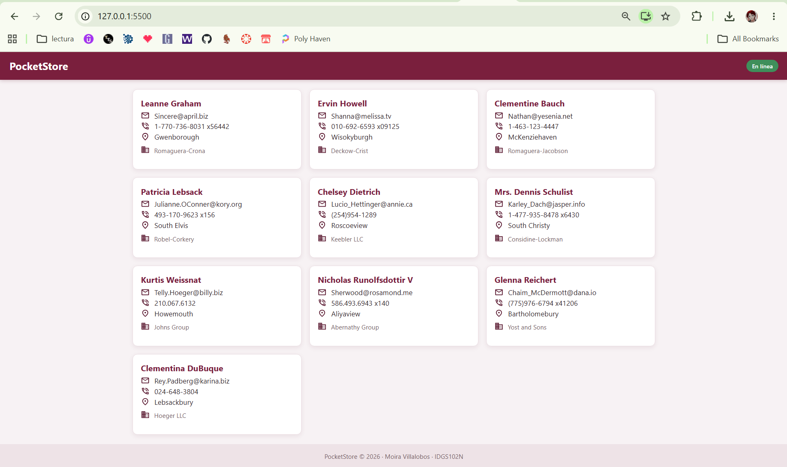

### 5. Pruebas y verificación

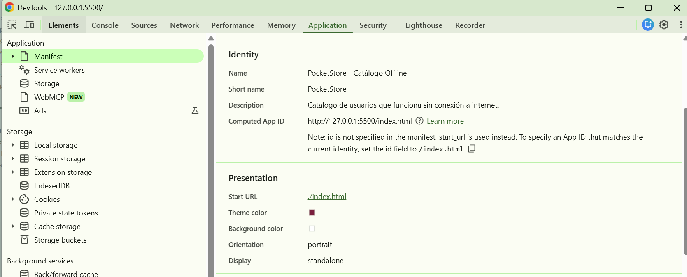
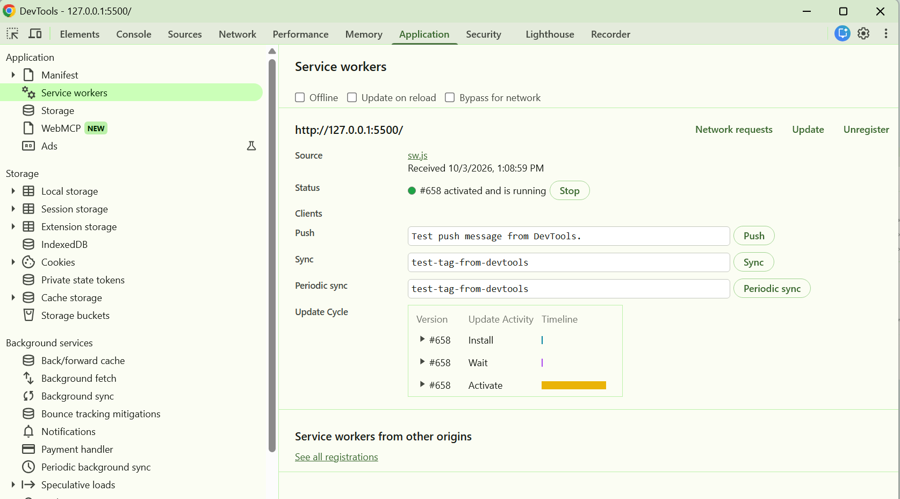
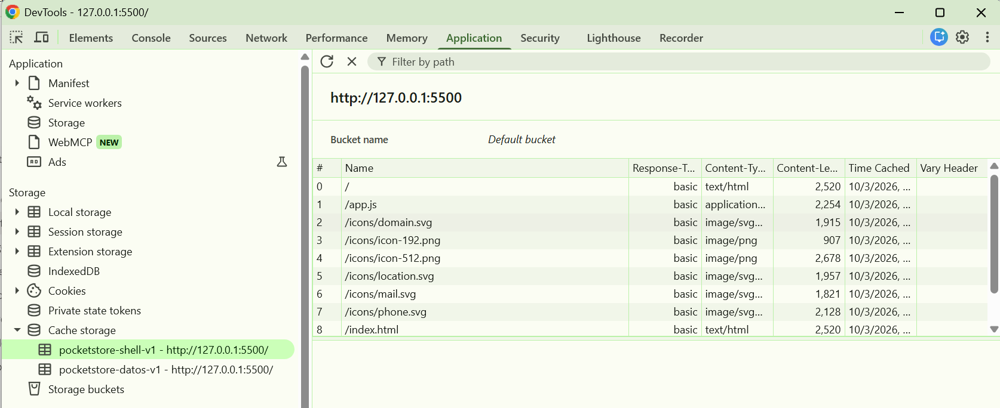
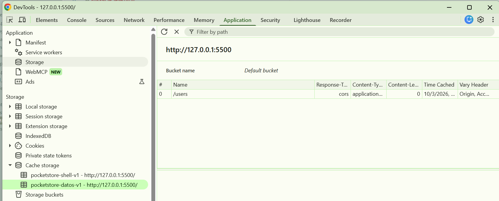
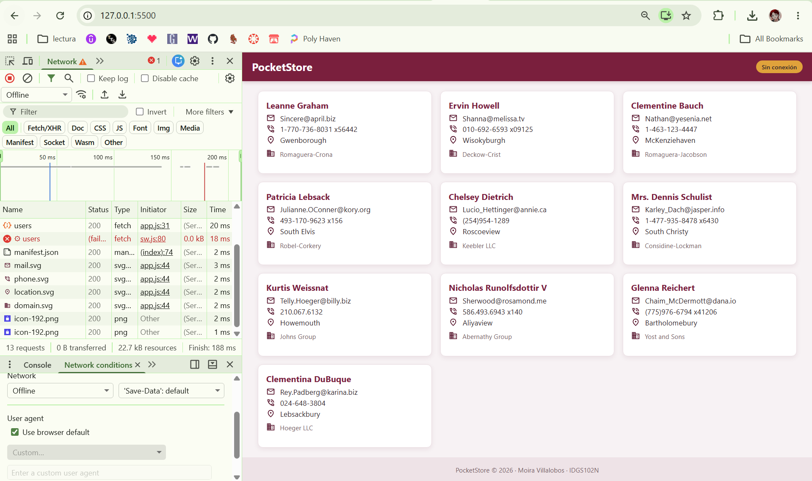
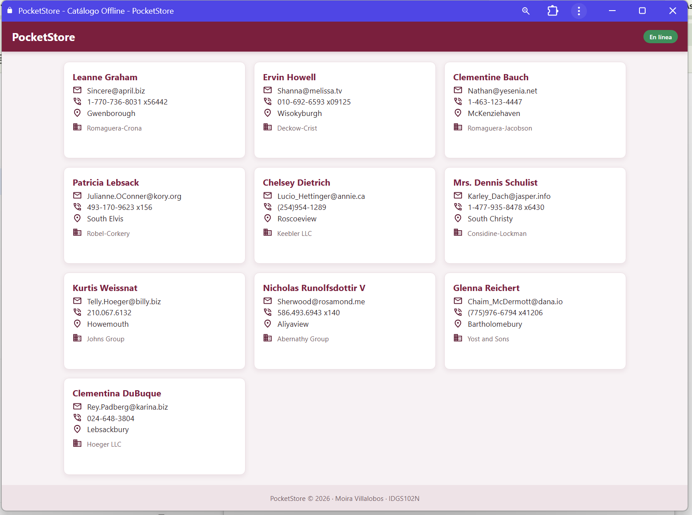

## Conclusiones

*Con PocketStore fue posible comprender cómo una aplicación web puede funcionar sin conexión y instalarse como una app nativa usando solo HTML, CSS y JavaScript. El manifiesto permite instalarla, el App Shell hace que cargue al instante y el Service Worker administra la caché para que el catálogo siga disponible sin internet. Lo más importante fue entender las estrategias de caché: Cache First para el App Shell y Network First para los datos de la API. En conclusión, las PWA mejoran la experiencia del usuario incluso con conexiones lentas o inexistentes.*
